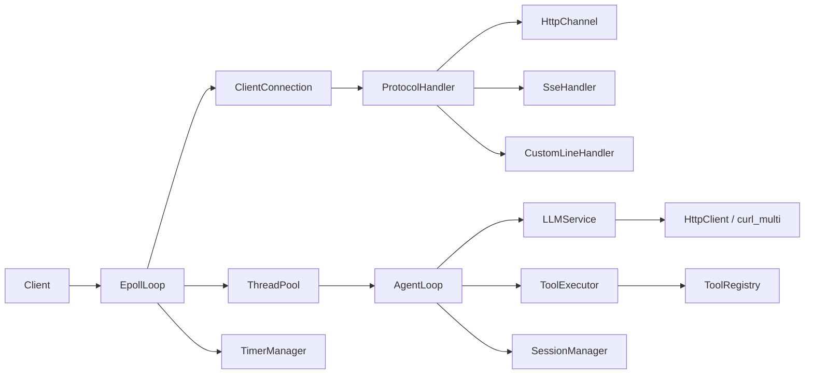

# C++ 事件驱动 LLM 网关

[](https://github.com/SecondMonbo/cpp-llm-gateway/actions/workflows/ci.yml)

基于 **epoll 边缘触发 + 非阻塞 I/O** 的 C++17 网关，面向 **LLM 流式对话** 和 **最小 Agent 工具调用**。包含 HTTP/1.1、SSE、静态文件服务、自定义行协议、线程池、定时器、资源限制和客户端断开取消。

> 定位：个人学习/求职项目，非生产级 Agent 平台。项目重点：事件驱动网络层、连接生命周期、异步任务和 SSE 流式链路。

---

## 项目定位

- **网络层**：单 reactor epoll ET、非阻塞 socket、写缓冲 + `EPOLLOUT`、eventfd 唤醒。
- **协议层**：HTTP/1.1、SSE、自定义行协议，通过 `ProtocolHandler` 抽象切换。
- **业务层**：DeepSeek OpenAI 兼容接口、多轮工具调用、会话记忆。
- **工程化**：GoogleTest + CTest、Python 集成测试、ASan/UBSan、GitHub Actions。

不包含：多 reactor、WebSocket、RAG、多 provider 路由、鉴权/限流、持久化存储。

---

## 功能特性

| 模块     | 能力                                                                            |
| -------- | ------------------------------------------------------------------------------- |
| 事件循环 | epoll ET + 非阻塞 I/O，读/写处理 `EAGAIN`，正确处理半关闭和 RST                 |
| HTTP/1.1 | 请求行/头部/`Content-Length` Body 解析，GET/POST，Keep-Alive，静态文件，MIME    |
| SSE      | chunked 传输、3 秒心跳、`content`/`reasoning`/`tool_result`/`error`/`done` 事件 |
| LLM      | DeepSeek 流式接口，`reasoning_content`、增量 `tool_calls`、最多 10 轮工具循环   |
| 工具     | 注册表 + 执行器，内置 `get_current_time`，错误/异常正确标记失败                 |
| 异步     | 4 worker 线程池 + 完成队列，回调回主线程，避免跨线程写 socket                   |
| 定时器   | 最小堆 + `epoll_wait` timeout，锁外回调，支持周期任务、取消、回调内增删         |
| 生命周期 | `shared_ptr` 连接、`weak_ptr` 反向引用、`unique_ptr` 协议/上下文所有权          |
| 取消     | 客户端断开后通过共享 `atomic<bool>` + `curl_multi` 轮询中止 LLM 请求            |
| 资源保护 | header/body/读写缓冲/连接数上限，空闲连接和会话过期清理                         |
| 测试     | 5 个 GoogleTest 单元测试 + 1 个 Python 端到端集成测试                           |

---

## 技术栈

- C++17
- Linux / WSL2
- epoll、eventfd、非阻塞 socket
- libcurl（`curl_multi`）
- nlohmann/json
- CMake + CTest
- GoogleTest（测试时通过 FetchContent 获取）
- Python 3（集成测试，仅标准库）

---

## 项目结构

```text
.
├── CMakeLists.txt
├── LICENSE
├── README.md
├── include/
│   ├── core/
│   │   ├── ClientConnection.hpp
│   │   ├── ConnectionContext.hpp
│   │   ├── EpollLoop.hpp
│   │   ├── Limits.hpp
│   │   ├── ThreadPool.hpp
│   │   └── TimerManager.hpp
│   ├── llm/
│   │   ├── AgentLoop.hpp
│   │   ├── HttpClient.hpp
│   │   ├── LLMService.hpp
│   │   └── SessionManager.hpp
│   ├── protocol/
│   │   ├── CustomLineHandler.hpp
│   │   ├── HttpChannel.hpp
│   │   ├── ProtocolHandler.hpp
│   │   └── SseHandler.hpp
│   ├── tools/
│   │   ├── ToolDefinition.hpp
│   │   ├── ToolExecutor.hpp
│   │   ├── ToolRegistry.hpp
│   │   └── builtin/TimeTool.hpp
│   └── third_party/json.hpp
├── src/
│   ├── main.cpp
│   ├── core/...
│   ├── llm/...
│   ├── protocol/...
│   └── tools/...
├── tests/
│   ├── CMakeLists.txt
│   ├── unit/
│   └── integration/test_gateway.py
├── docs/class-diagram.md
├── www/index.html
└── .github/workflows/ci.yml
```

完整类图见 [docs/class-diagram.md](docs/class-diagram.md)。

---

## 快速开始

### 环境要求

- Linux / WSL2（Ubuntu 22.04+）
- GCC 11+ / Clang 14+
- CMake 3.16+
- `libcurl` 开发包、`pkg-config`
- Python 3（仅测试需要）

Ubuntu 安装：

```bash
sudo apt update
sudo apt install -y build-essential cmake pkg-config libcurl4-openssl-dev
```

> 测试使用 CMake `FetchContent` 下载 GoogleTest，第一次配置需要网络；没有网络时可改用系统 `libgtest-dev` 或把 gtest 源码放进 `third_party/`。

### 编译

```bash
git clone https://github.com/SecondMonbo/cpp-llm-gateway.git
cd cpp-llm-gateway

cmake -S . -B build -DCMAKE_BUILD_TYPE=Release
cmake --build build -j
```

### 运行

```bash
export DEEPSEEK_API_KEY=sk-xxxxxxxx
./build/gateway
```

默认监听 `12010`，可通过 `GATEWAY_PORT` 修改：

```bash
GATEWAY_PORT=18080 ./build/gateway
```

> 未设置 `DEEPSEEK_API_KEY` 时服务仍可启动，静态文件、`/events` 和错误响应可用；`/v1/chat` 会返回 SSE `error` + `done`。

---

## 配置

| 环境变量            | 默认值                                         | 说明                                         |
| ------------------- | ---------------------------------------------- | -------------------------------------------- |
| `GATEWAY_PORT`      | `12010`                                        | 监听端口；非法值启动失败                     |
| `DEEPSEEK_API_KEY`  | 无                                             | DeepSeek API Key；`/v1/chat` 必需            |
| `DEEPSEEK_BASE_URL` | `https://api.deepseek.com/v1/chat/completions` | 上游完整 URL，可指向 mock/兼容服务           |
| `DEEPSEEK_MODEL`    | `deepseek-chat`                                | 仅 DeepSeek 后端使用；本地后端占位为 `Phi-3` |

示例：

```bash
export DEEPSEEK_API_KEY=sk-xxxxxxxx
export DEEPSEEK_BASE_URL=https://api.deepseek.com/v1/chat/completions
export DEEPSEEK_MODEL=deepseek-chat
export GATEWAY_PORT=12010
./build/gateway
```

---

## API

### 静态文件

```bash
curl -i http://127.0.0.1:12010/
curl -i http://127.0.0.1:12010/index.html
curl -i 'http://127.0.0.1:12010/index.html?x=1'
```

- 静态根目录为可执行文件同级的 `../www`；
- 路径穿越返回 `403`；
- 文件不存在返回 `404`；
- 非 GET/POST 方法返回 `405` + `Allow`；
- 静态文件使用 `Content-Length`，不使用 chunked。

### SSE 心跳

```bash
curl -N -H 'Accept: text/event-stream' \
  http://127.0.0.1:12010/events
```

响应每 3 秒推送：

```text
event: heartbeat
data: Current time: ...
```

- 使用 `Transfer-Encoding: chunked` + `Connection: keep-alive`；
- 客户端断开后连接和定时器会被清理；
- 浏览器可以用 `EventSource('/events')`。

### 对话接口 `POST /v1/chat`

```bash
curl -N -X POST http://127.0.0.1:12010/v1/chat \
  -H 'Content-Type: application/json' \
  -d '{"session_id":"demo","message":"现在几点？"}'
```

响应：

```text
event: content
data: 现在

event: tool_result
data: 2026-11-03 22:30:00

event: content
data: 现在是 2026-11-03 22:30:00

event: done
data: [DONE]
```

事件说明：

| event         | 说明                          |
| ------------- | ----------------------------- |
| `content`     | 模型正文增量                  |
| `reasoning`   | 思考过程增量                  |
| `tool_result` | 工具执行结果                  |
| `error`       | LLM 调用失败、缺少 API Key 等 |
| `done`        | 本轮结束，data 为 `[DONE]`    |

- chat 使用 `Transfer-Encoding: chunked` + `Connection: close`；
- 成功和失败都会以 `done` 结束；
- 客户端断开时，AgentLoop 通过取消令牌和 `curl_multi` 尽快中止上游请求；
- **浏览器不要用 `EventSource` 调 `/v1/chat`**：`EventSource` 只支持 GET，chat 是 POST。浏览器请用 `fetch` + `ReadableStream` 解析 SSE。

### 自定义行协议

```bash
printf 'PING|hello\n' | nc 127.0.0.1 12010
# PONG|hello

printf 'TOOL|time\n' | nc 127.0.0.1 12010
# TOOL_RES|...
```

支持：

- `PING|<payload>` → `PONG|<payload>`
- `CHAT|<payload>` → `CHAT_ACK|<payload>`
- `TOOL|time` → `TOOL_RES|<当前时间>`

---

## 架构



详细类图：[docs/class-diagram.md](docs/class-diagram.md)。

一次 `/v1/chat` 的路径：

```text
EpollLoop
  -> ClientConnection::on_readable
  -> HttpChannel::process
  -> UPGRADE_SSE
  -> SseHandler
  -> ThreadPool -> AgentLoop::run
  -> LLMService::call
  -> HttpClient / curl_multi
  -> 工具执行 / 多轮循环
  -> ThreadPool completion
  -> ClientConnection::send_data
```

---

## 关键设计

### 1. epoll ET + 写缓冲

- 读事件一次读到 `EAGAIN`；
- 写不完整时进入 `write_buffer_` 并注册 `EPOLLOUT`；
- `EPOLLOUT` 到达后继续发送，清空后取消写事件；
- 发送使用 `MSG_NOSIGNAL`，避免客户端 RST 触发 SIGPIPE。

### 2. 连接生命周期

- `EpollLoop` 用 `unordered_map<int, shared_ptr<ClientConnection>>` 持有连接；
- `ConnectionContext` 用 `weak_ptr<ClientConnection>` 反向引用，避免循环；
- `ClientConnection` 用 `unique_ptr` 持有 `ConnectionContext` 和当前 `ProtocolHandler`；
- 协议升级 SSE 时替换 handler，旧 handler 先析构，ctx 后析构。

### 3. 线程池与完成队列

- 阻塞的 LLM/工具调用交给 worker；
- 完成回调通过 `ThreadPool::post_completion` 回主线程；
- 回调捕获 `weak_ptr<ClientConnection>`，客户端断开后自动丢弃；
- 事件循环用 eventfd 唤醒，不轮询。

### 4. 定时器

- `TimerManager` 使用最小堆 + `epoll_wait` 超时；
- 回调在锁外执行，避免回调内 `add_timer/cancel_timer` 死锁；
- 周期任务回调后重新入堆；
- 空闲连接检查每 1 秒一次，超过 60 秒关闭；
- Session 清理每 60 秒一次。

### 5. SSE chunked 与心跳

- `format_sse_message` 负责事件格式；
- `chunk()` 负责 HTTP chunk 帧；
- `/events` 使用 chunked + keep-alive，3 秒心跳；
- `/v1/chat` 使用 chunked + close，`done` 后结束；
- 待发送事件队列有上限，慢客户端不会无限堆积。

### 6. DeepSeek 取消

- `ConnectionContext` 持有 `shared_ptr<atomic<bool>> canceled`；
- `ClientConnection` 关闭时 `store(true)`；
- `LLMService` 把指针传到 `HttpClient`；
- `HttpClient` 使用 `curl_multi`，每 100ms 检查 token；
- 客户端断开后约 100ms 内中止传输，worker 可以继续接任务。

### 7. 会话记忆

- `SessionManager` 保存每个 `session_id` 的消息；
- 按 user turn 边界裁剪，避免切断 assistant `tool_calls` 和 tool 响应；
- 保留开头 system 消息；
- 最多 100 条消息，60 秒扫描、1 小时无活动清理；
- 不做摘要压缩。

---

## 资源限制

在 `include/core/Limits.hpp` 中集中定义：

| 限制             | 值    |
| ---------------- | ----- |
| header 总字节    | 8 KB  |
| header 数量      | 100   |
| body             | 1 MB  |
| read buffer      | 2 MB  |
| write buffer     | 4 MB  |
| 最大连接数       | 512   |
| 空闲连接超时     | 60 秒 |
| 空闲检查间隔     | 1 秒  |
| session 清理间隔 | 60 秒 |

超限行为：

- header 过大 → `431`
- body 过大 → `413`
- 读/写缓冲过大 → 关闭连接
- 连接数超限 → `503`
- 空闲连接 → 主动关闭

---

## 测试

### 构建并运行 CTest

```bash
cmake -S . -B build -DCMAKE_BUILD_TYPE=Release
cmake --build build -j
ctest --test-dir build --output-on-failure
```

当前测试：

- 5 个 GoogleTest 单元测试程序；
- 1 个 Python 端到端集成测试；
- 覆盖 Session、Timer、SSE、Tools、ThreadPool，以及静态文件、Keep-Alive、chat、tool_calls、心跳、取消、431/413。

### ASan / UBSan

```bash
cmake -S . -B build-asan \
  -DCMAKE_BUILD_TYPE=Debug \
  -DCMAKE_CXX_FLAGS="-fsanitize=address,undefined -fno-omit-frame-pointer -g" \
  -DCMAKE_EXE_LINKER_FLAGS="-fsanitize=address,undefined"

cmake --build build-asan -j

ASAN_OPTIONS=detect_leaks=1:abort_on_error=1 \
  UBSAN_OPTIONS=halt_on_error=1 \
  ctest --test-dir build-asan --output-on-failure
```

### TSan

```bash
cmake -S . -B build-tsan \
  -DCMAKE_BUILD_TYPE=Debug \
  -DCMAKE_CXX_FLAGS="-fsanitize=thread -fno-omit-frame-pointer -g" \
  -DCMAKE_EXE_LINKER_FLAGS="-fsanitize=thread"

cmake --build build-tsan -j

# 某些内核需要关闭 ASLR 才能运行 TSan
setarch $(uname -m) -R ./build-tsan/tests/test_session_manager
```

### CI

GitHub Actions 包含：

- Release 构建 + ctest；
- ASan/UBSan 构建 + ctest。

---

## 已知限制

- **单 reactor**：一个 epoll 事件循环 + 4 个 worker，不是多 reactor/多进程架构。
- **只实现 DeepSeek 后端**：`LOCAL_LLAMA` 和 `call_llama` 仍是占位，本地 `Phi-3` 不支持工具调用。
- **不做上下文摘要**：只按 user turn 截断，长对话会丢失早期上下文。
- **取消是协作式的**：`curl_multi` 100ms 轮询，上游可能短暂继续；工具函数执行中不可抢占。
- **静态文件在事件循环线程读取**：大文件可能阻塞其他连接，未使用 `sendfile`。
- **slowloris 只做了基础防护**：有 header/body/read buffer 上限和 idle timeout，但没有独立的“请求头截止时间”。
- **没有 WebSocket、RAG、多 provider、鉴权、限流、metrics、Docker、优雅停机**。
- **会话存储在进程内**：重启丢失，不是 Redis/分布式存储。
- **没有附带可复现 benchmark**：不提供未经复测的 QPS 数字。

---

## 后续方向

- [ ] 多 reactor + 连接分片
- [ ] WebSocket
- [ ] 多 provider 路由与故障转移
- [ ] 上下文摘要压缩
- [ ] 鉴权、限流、请求 ID、metrics
- [ ] 静态文件 `sendfile` / 异步文件 I/O
- [ ] Docker / 优雅停机
- [ ] 可复现的 wrk benchmark

---

## License

MIT License，见 [LICENSE](LICENSE)。
