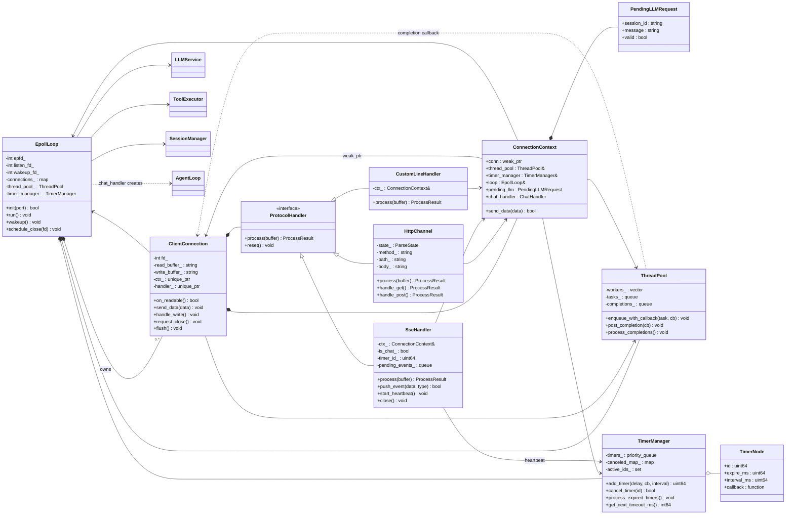
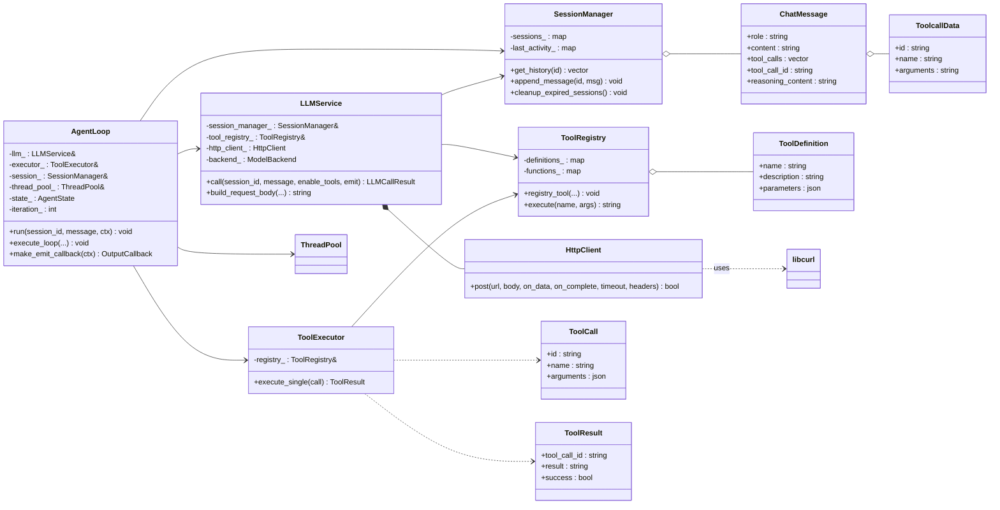

# Gateway 类图

> 对应代码：`bd87bcf`
> 说明：只画核心类与关键关系，省略了大部分 getter/setter、枚举、结构体字段和工具函数。
> 图中 `*--` 表示拥有，`-->` 表示使用/引用，`..>` 表示创建/调用/弱依赖，`<|--` 表示继承/实现。

---

## 0. 整体结构

```text
main
 ├─ SessionManager
 ├─ ToolRegistry  ← register_time_tool()
 ├─ ToolExecutor
 ├─ LLMService ── HttpClient
 └─ EpollLoop
      ├─ ThreadPool
      ├─ TimerManager ── TimerNode
      └─ ClientConnection (N 个)
           ├─ ConnectionContext
           └─ ProtocolHandler
                ├─ HttpChannel
                ├─ SseHandler
                └─ CustomLineHandler
```

---

## 1. 核心运行时类图



---

## 2. Agent 与 Tool 类图



---

## 3. 关系说明

### 3.1 网络层

- `EpollLoop` 拥有 `ClientConnection`：`connections_` 是 `fd -> shared_ptr<ClientConnection>`；连接断开后 `erase`，引用计数归零时析构。
- `EpollLoop` 还拥有 `ThreadPool` 和 `TimerManager`；对 `LLMService`、`ToolExecutor`、`SessionManager` 只持有引用，这三个是 `main` 里的全局服务。
- `ClientConnection` 拥有 `ctx_`（`unique_ptr<ConnectionContext>`）和 `handler_`（`unique_ptr<ProtocolHandler>`）。
- 成员声明顺序保证析构时先销毁 `handler_`，再销毁 `ctx_`，避免协议层持有悬垂的 `ConnectionContext`。

### 3.2 协议层

- `ProtocolHandler` 是抽象基类，三个实现：
  - `HttpChannel`：HTTP 解析、GET/POST 分发、静态文件；
  - `SseHandler`：SSE 握手、事件发送、心跳；
  - `CustomLineHandler`：`PING|` / `CHAT|` 行协议。
- 三个实现都只持有 `const ConnectionContext&`，不拥有连接。
- `ConnectionContext` 反向持有 `weak_ptr<ClientConnection>`，避免 `shared_ptr` 循环引用。
- 协议层通过 `ctx_.get_conn()` 判断连接是否还活着，通过 `ctx_.send_data()` 发送数据。

### 3.3 异步层

- `ThreadPool` 负责 worker 线程、任务队列和完成队列。
- `AgentLoop` 不直接写 socket；它通过 `OutputCallback` 把事件投递到 `ThreadPool` 的完成队列，由主线程执行 `ClientConnection::send_data()`。
- 完成回调捕获 `weak_ptr<ClientConnection>`，连接断开后自动丢弃事件，避免悬垂指针。

### 3.4 定时器层

- `TimerManager` 只管理 `TimerNode`，不认识连接。
- `SseHandler` 的 `timer_id_` 对应一个周期 timer；`close()` 里 `cancel_timer`，回调里检查 `closed_`。
- `TimerManager` 的回调在 `EpollLoop::run()` 中、**锁外**执行；周期任务在回调返回后重新入堆。

### 3.5 Agent 与 Tool

- `AgentLoop` 每次聊天请求创建一个，在线程池里运行；持有 `LLMService`、`ToolExecutor`、`SessionManager`、`ThreadPool` 的引用。
- `LLMService` 负责单次 LLM 调用：构造请求、解析 SSE、累积 `tool_calls`；持有 `HttpClient`。
- `HttpClient` 每次 `post()` 新建 `CURL*`，不跨线程共享 easy handle。
- `ToolExecutor` 通过 `ToolRegistry` 执行工具；`ToolRegistry` 存储 `ToolDefinition` 和 `std::function`。
- `SessionManager` 保存 `ChatMessage` 历史；`ChatMessage` 里的 `ToolcallData` 用于回传工具调用。

---

## 4. 面试时怎么讲这张图

1. **先讲纵向分层**：网络层（`EpollLoop` / `ClientConnection`）→ 协议层（`ProtocolHandler`）→ 业务层（`SseHandler` / `AgentLoop`）→ 服务层（`LLMService` / `ToolRegistry` / `SessionManager`）。
2. **再讲一次请求的路径**：
   `EpollLoop` 收到事件 → `ClientConnection::on_readable` → `ProtocolHandler::process` → `HttpChannel` 升级 → `SseHandler` → `AgentLoop` → `LLMService` → `HttpClient`。
3. **最后讲三个设计点**：
   - `weak_ptr` 解决连接生命周期；
   - 线程池完成队列把阻塞调用移出事件循环；
   - `ProtocolHandler` 抽象让 HTTP/SSE/自定义协议可以切换。

---

## 5. README 简化建议

README 里不建议放完整类图，只保留“整体结构”和第一张图的简化版（去掉字段/方法）。完整版放本文件，作为 `docs/architecture.md` 的补充。
